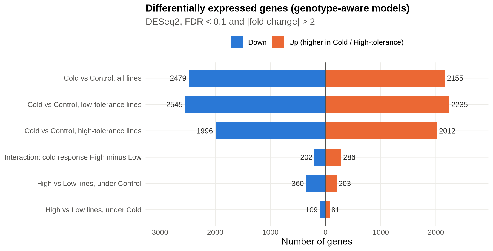
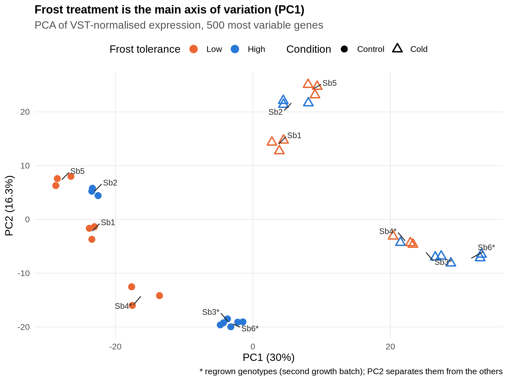
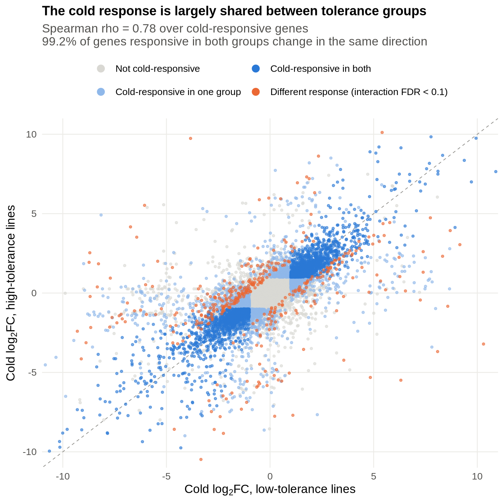
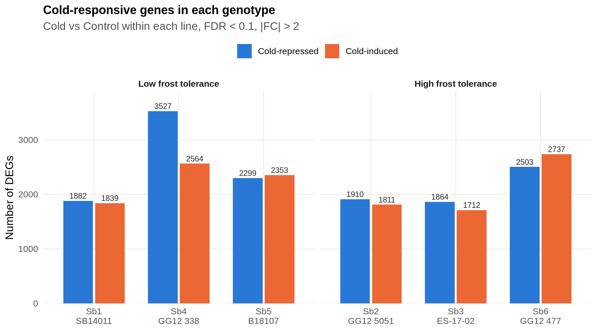
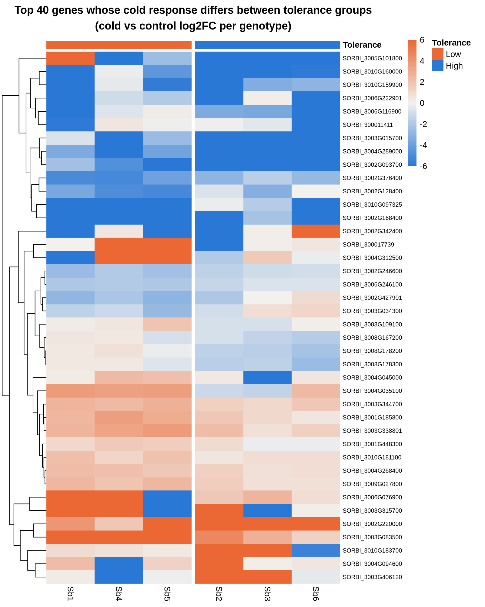

# Transcriptomic Response to Cold Stress in Sorghum


RNA-seq analysis of frost stress (−5 °C) in six *Sorghum bicolor* lines that differ in frost tolerance.
This project was my M.Sc. thesis in Agrobiotechnology at Justus-Liebig-Universität Gießen.

**Question:** Which genes respond to frost in sorghum seedlings, and do frost-tolerant and frost-sensitive lines respond differently?
The original project brief and the analysis plan are in [`docs/research_plan.md`](docs/research_plan.md).

<p align="center"></p>

---

## Contents

- [Experimental design](#experimental-design)
- [Workflow](#workflow)
- [Key findings](#key-findings)
- [What changed from the iDEP analysis](#what-changed-from-the-idep-analysis)
- [Repository layout](#repository-layout)
- [Reproducing the analysis](#reproducing-the-analysis)
- [Limitations and next steps](#limitations-and-next-steps)
- [Citation](#citation)

## Experimental design

| Code | Line | Frost tolerance | Control | Frost |
|------|------|----------------|:------:|:----:|
| Sb1 | SB14011   | Low  | 3 | 3 |
| Sb4 | GG12 338  | Low  | 3 | 3 |
| Sb5 | B18107    | Low  | 3 | 3 |
| Sb2 | GG12 5051 | High | 3 | 3 |
| Sb3 | ES-17-02  | High | 3 | 3 |
| Sb6 | GG12 477  | High | 3 | 3 |

- **Plants:** two-week-old seedlings.
- **Frost treatment:** 2 h at **−5 °C in the dark**.
- **Control:** plants grown under the same conditions, without the frost treatment.
- **Replicates:** three biological replicates per line and condition. **Each library is a pool of 3 plants.**
- **Regrown genotypes:** Sb4 and Sb6, and Sb3 except library Sb3-S1, had to be regrown. Their libraries are numbered 4–6 (e.g. `Sb4-C4`), and pools 1–3 of those plants were not sequenced. These libraries form a second growth batch (see [batch check](#5-batch-check-for-the-regrown-genotypes)).

That gives **36 libraries**, each with 108–172 million assigned reads, covering **30,945 genes**.
The full sample sheet is in [`data/metadata/sample_sheet.csv`](data/metadata/sample_sheet.csv). It includes the original library IDs, the growth batch and the pool size.

> **Naming note:** In the analysis sample names, **LT/HT mean low and high frost *tolerance***, not temperature. **C/S mean Control and frost Stress.**
> For example, `Sb4_LT_S_2` is line Sb4 (low tolerance), frost-stressed, second library (original ID `Sb4-S5`).
> In the code and tables, the frost treatment is the level `Cold` of the factor `condition`.

## Workflow

```
gene count matrix (36 samples)
   │
   ├── iDEP v2.4.3 (web app, thesis analysis) ───────────────► idep/
   │     filter ≥0.5 CPM in ≥1 sample → 22,810 genes
   │     EdgeR log-CPM → QC, PCA, clustering
   │     DESeq2 (~ tolerance + condition [+ interaction]) → DEGs, GO enrichment
   │
   └── command-line R / DESeq2 (this repo) ──────────────────► results/
         01  reproduce the iDEP models exactly
         02  genotype-aware models (nested design, per-genotype, pseudo-bulk)
         03  figures
         04  batch sensitivity checks (regrown genotypes)
```

DEG thresholds are the same everywhere: **FDR < 0.1 and |fold change| > 2**.

## Key findings

### 1. Frost changes the expression of about 4,600 genes (~20% of expressed genes)

Averaged over all six lines, 2,155 genes are frost-induced and 2,479 are frost-repressed (genotype-aware model, out of 22,810 expressed genes). In the tables these are labelled cold-induced / cold-repressed.
In the PCA, the frost treatment is the main axis of variation (PC1, 30%).
PC2 (16%) separates the three regrown genotypes (Sb3, Sb4, Sb6) from the other three. That axis reflects growth batch and genotype together, and this design cannot separate the two (see finding 5).

<p align="center"></p>

GO enrichment of the cold main effect (iDEP; the direction is corrected, see below):

| | Top enriched biological processes |
|---|---|
| **Cold-induced** | cell wall organisation / biogenesis, polysaccharide metabolism, response to jasmonic acid, response to wounding, response to fatty acid |
| **Cold-repressed** | response to heat, response to hydrogen peroxide, protein folding (small HSPs, HSP70), response to temperature stimulus |

The strongest named cold-induced genes include *arginine decarboxylase* (polyamine synthesis, annotated as a chilling-response gene; log2FC = 3.2), *phytoene synthase 1*, *lysophospholipid acyltransferase LPEAT2* (membrane lipid remodelling) and a *calcium-binding protein CP1*.
Chloroplast and photosynthesis-related genes are among the most repressed.

### 2. The core frost response is shared between tolerance groups

- **2,914 genes** are frost-responsive in both low- and high-tolerance lines. **99.2%** of them change in the same direction.
- Low-tolerance lines respond more broadly: 4,780 DEGs, against 4,008 in high-tolerance lines. Genotype Sb4 (GG12 338, low tolerance) has the largest response, with 6,091 DEGs, followed by Sb6 with 5,240. Both are regrown genotypes, so part of their larger response could come from the second growth batch. Sb3, also regrown, has the smallest response, so batch alone does not explain it.
- Across all frost-responsive genes, fold changes in the two groups are strongly correlated (Spearman ρ = 0.78).

<p align="center">
  
  
</p>

### 3. Frost-response genes that differ between tolerance groups

For **488 genes** the frost response differs between high- and low-tolerance lines (tolerance × cold interaction): 286 respond more positively in tolerant lines and 202 more negatively.
Named examples include a *WUSCHEL-related homeobox* transcription factor, a *florigen* (FT-like) gene, *glutamate dehydrogenase* and an ethylene/wound-responsive transcription factor. These respond more positively to frost in the tolerant lines.
A *GATA* transcription factor and a *nitrate transporter* go the other way (more negative response in tolerant lines).
The heatmap shows that several interaction genes also vary between lines within a tolerance group. These are good candidates for follow-up (qPCR) rather than final markers.

<p align="center"></p>

### 4. Differences between tolerance groups in the same condition are not robust

The tolerance groups are compared with **genotype as the unit of replication** (3 vs 3 lines; replicates summed per line).
This gives 563 DEGs under control conditions and only 190 under frost.
These lists are not stable, though. The groups are unbalanced for growth batch (1 of 3 low-tolerance lines regrown, 2 of 3 high-tolerance lines). Adding batch as a covariate changes the gene lists substantially (finding 5).
iDEP pooled all samples and reported 2,067 tolerance DEGs. About 20% of those have |log2FC| > 10, a sign of genes expressed in only some lines (presence/absence variation) rather than a tolerance effect.
In the iDEP results, genes higher in the tolerant lines were enriched for **terpenoid/diterpenoid biosynthesis**, and genes higher in the sensitive lines for **defence response and chitin catabolism**. Treat these as hypotheses, because that comparison is confounded with genotype.

### 5. Batch check for the regrown genotypes

Batch is nested in genotype for Sb4 and Sb6, so the genotype terms in the models absorb it. Two checks with [`scripts/04_batch_sensitivity.R`](scripts/04_batch_sensitivity.R) ([table](results/tables/batch_sensitivity.csv)):

| Check | Contrast | Main DEGs | Re-fitted DEGs | Overlap (Jaccard) |
|---|---|---:|---:|---:|
| Drop Sb3-S1, the only original-batch Sb3 library | Frost response, low-tolerance lines | 4,780 | 4,784 | 0.99 |
| | Frost response, high-tolerance lines | 4,008 | 4,221 | 0.89 |
| | Interaction (High − Low) | 488 | 549 | 0.75 |
| Add batch covariate to the line-level comparison | High vs Low, control | 563 | 1,247 | 0.32 |
| | High vs Low, frost | 190 | 832 | 0.19 |

- **The frost responses are robust.** Sb3-S1 also correlates at r = 0.98 with its regrown replicates (Sb3-S4, Sb3-S5), so the batch shift within a genotype looks small.
- **The interaction is moderately robust.** About three quarters of the genes are shared.
- **Line-level tolerance differences are not robust.** With 6 pooled samples and batch almost aligned with tolerance group, this design cannot reliably separate constitutive tolerance differences from batch or genotype.

## What changed from the iDEP analysis

The thesis analysis was done in the [iDEP](https://doi.org/10.1186/s12859-018-2486-6) web app. Re-running it from the command line (`scripts/01_reproduce_idep.R`) **reproduces the iDEP DEG counts** ([summary](results/tables/summary_idep_reproduction.csv)). They match exactly, except that 1,138 genes higher in the low-tolerance lines matches iDEP's *C (LT vs HT)* run, while its *S (LT vs HT)* run reported 1,131. It also exposed three issues, which the genotype-aware analysis (`scripts/02_deseq2_genotype_aware.R`) addresses:

| Issue in the iDEP runs | Consequence | Fix |
|---|---|---|
| The DESeq2 contrast for *C vs S* was **Control / Stress** | Genes labelled "Upregulated" were actually **lower under cold** (checked against the counts) | All contrasts are written as Cold vs Control and High vs Low. iDEP files were relabelled (`cold_induced`, `cold_repressed`, …) |
| Additive model `~ tolerance + condition` for the "LT (C vs S)" and "HT (C vs S)" runs | Both runs estimate the **same** pooled cold effect (99.6% identical gene lists), so there was no real per-group comparison. The same applies to "C (LT vs HT)" and "S (LT vs HT)" | Nested design `~ tolerance + tolerance:genotype_n + tolerance:condition` gives a separate cold effect for each tolerance group, plus their difference |
| Genotype not in the model | Genotype-specific genes inflate tolerance and interaction results (64% of iDEP interaction DEGs have \|log2FC\| > 10) | Genotype in every model. Tolerance groups compared at the line level (pseudo-bulk) |

Most of the cold response is robust to the change: the genotype-aware model recovers 90% of iDEP's cold-induced genes and 92% of its cold-repressed genes.

## Repository layout

```
├── data/
│   ├── metadata/sample_sheet.csv        36 samples: line, tolerance, condition, replicate
│   ├── metadata/gene_descriptions.csv   gene descriptions exported from iDEP (5,020 genes)
│   └── raw/                             count matrix goes here (not distributed, see data/README.md)
├── scripts/
│   ├── utils.R                          shared parameters and helpers
│   ├── 01_reproduce_idep.R              iDEP models, command-line reproduction
│   ├── 02_deseq2_genotype_aware.R       corrected models (M1 nested, M2 per genotype, M3 pseudo-bulk)
│   ├── 03_figures.R                     figures in results/figures
│   └── 04_batch_sensitivity.R           checks for the regrown-genotype batch
├── results/
│   ├── tables/DE_<contrast>.csv.gz      full DESeq2 results for every gene
│   ├── tables/DEG_<contrast>.csv        significant genes only
│   ├── tables/summary_DEG_counts.csv    DEG counts for all contrasts
│   └── figures/                         figures used in this README
├── idep/                                original iDEP outputs (cleaned and relabelled), see idep/README.md
│   ├── exploratory/                     pre-processing QC, PCA/t-SNE/MDS, clustering
│   ├── results/                         DEG lists, GO enrichment and plots for 3 contrasts
│   ├── generated_code/                  R code exported by iDEP (unmodified)
│   └── reports/                         iDEP HTML reports
├── docs/methods.md                      detailed methods
├── docs/research_plan.md                project brief and analysis plan
├── environment.yml                      conda environment (R + Bioconductor)
└── run_all.sh                           runs scripts 01 → 03
```

## Reproducing the analysis

```bash
git clone https://github.com/shajedurhossain/Transcriptomic-Response-to-Cold-Stress-in-Sorghum.git
cd Transcriptomic-Response-to-Cold-Stress-in-Sorghum

conda env create -f environment.yml
conda activate sorghum-cold-rnaseq

# put the count matrix at data/raw/sorghum_gene_count_matrix.csv (see data/README.md)
bash run_all.sh        # ~10 min on a laptop
```

The raw count matrix is not distributed with this repository. All derived results (DESeq2 tables, figures) are included, so the findings can be inspected without re-running anything.

## Limitations and next steps

- **Gene annotation is limited.** Descriptions are available only for the ~5,000 genes that iDEP returned, and 90% of those are "hypothetical protein". Adding Phytozome / Ensembl Plants annotation (or orthology to *Arabidopsis* and maize cold genes such as *CBF/DREB1*, *COR*, *LEA*, dehydrins) would make interpretation much stronger.
- **GO enrichment comes from iDEP** and covers the pooled contrasts only. Running it again (e.g. clusterProfiler or g:Profiler) on the genotype-aware contrasts is the obvious next step.
- **Three lines per tolerance group** limits power for group-level conclusions. Line-specific responses (e.g. Sb4) can dominate.
- **Growth batch.** Three genotypes were regrown, so batch is confounded with genotype and partly with tolerance group (finding 5). Group-level differences in the same condition should be confirmed with a balanced experiment.
- **Gene IDs.** The counts were generated against the *S. bicolor* **v5.1** annotation (`Sobic.001G000300.v5.1`). For iDEP, the IDs were renamed by pattern to the Ensembl v3 format (`SORBI_3001G000300`). Most gene numbers carry over between versions, but not all, so iDEP's annotation and GO terms may be wrong for genes that were renumbered or newly added in v5. Re-annotating against v5.1 directly would fix this.
- **One time point and one tissue.** Samples were taken after a single 2 h frost exposure, which captures the early response only. Pooling 3 plants per library averages out plant-to-plant variation.
- Low-count genes can still give extreme fold changes in the interaction contrast. Use `baseMean` filtering or `lfcShrink()` when ranking candidates.

## Citation

If you use this code or the results, please cite this repository (see [`CITATION.cff`](CITATION.cff)) and the tools:

- Love MI, Huber W, Anders S (2014). Moderated estimation of fold change and dispersion for RNA-seq data with DESeq2. *Genome Biology* 15:550.
- Ge SX, Son EW, Yao R (2018). iDEP: an integrated web application for differential expression and pathway analysis of RNA-Seq data. *BMC Bioinformatics* 19:534.

---
*Author: Md Shajedur Hossain, M.Sc. Agrobiotechnology, Justus-Liebig-Universität Gießen.*
